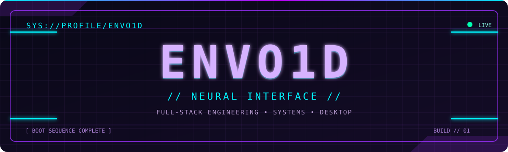

<div align="center">



<br />

[](https://git.io/typing-svg)


</div>

### `> whoami`

```text
┌─[ENVO1D@neural-interface]─[~]
└──╼ $ cat /etc/developer
ROLE       : Software Developer
FOCUS      : Full-stack applications / APIs / Systems / Desktop
STACK      : Node.js • C# • Rust
MISSION    : Build fast, reliable and thoughtfully designed software.
STATUS     : ONLINE ▮
```

### `> load_modules --all`

<div align="center">


**FRONTEND // INTERFACES**


**BACKEND // INFRASTRUCTURE**


**SYSTEMS // DESKTOP**

</div>

### `> inspect --telemetry`

<div align="center">


</div>

### `> execute contribution_snake --neon`

<div align="center">


</div>

### `> tail -f /var/log/neural-interface`

```text
[ OK ] interface initialized
[ OK ] stack modules loaded
[ OK ] telemetry connected
[ .. ] awaiting next deployment_
```

<div align="center">


`// END OF TRANSMISSION //`

</div>
